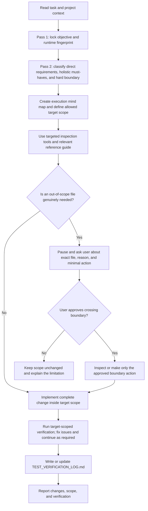

# Strict Scope Mindmap

A scope-aware planning Skill for AI coding agents: clarify the request, map the work and boundaries, inspect targeted code, and verify the requested change without turning it into an unrelated repository-wide task.

## Table of contents

- [Overview](#overview)
- [The problem it addresses](#the-problem-it-addresses)
- [Key features](#key-features)
- [How it works](#how-it-works)
- [Workflow](#workflow)
- [Scope-boundary principles](#scope-boundary-principles)
- [Installation](#installation)
- [Usage](#usage)
- [Example planning process](#example-planning-process)
- [Mind-map structure](#mind-map-structure)
- [Tool routing and testing](#tool-routing-and-testing)
- [Best practices](#best-practices)
- [Limitations and confirmation points](#limitations-and-confirmation-points)
- [FAQ](#faq)
- [Contributing](#contributing)
- [License](#license)

## Overview

Strict Scope Mindmap is a set of instructions, reference guides, plugin manifests, and installation scripts for AI agents working on software tasks. Before implementation, the Skill asks the agent to identify the primary outcome, classify requirements and boundaries, and sketch an execution mind map. It then directs the agent toward focused code inspection, complete changes within the approved target scope, and task-appropriate verification.

It is a planning and workflow aid—not a test runner or an enforcement mechanism that independently controls an agent. The repository includes catalogs of tools and example configurations; actual tool availability depends on the agent's environment.

## The problem it addresses

Coding requests often combine a desired outcome with explicit constraints, unstated dependencies, and nearby features that should not be changed. An agent can miss a necessary consumer update by staying too narrow, or create scope creep by searching and editing broadly. Testing can also be poorly matched to the project or overlook edge cases.

This Skill provides a repeatable way to balance those concerns: make requirements and boundaries explicit first, inspect the target deliberately, identify dependencies that may require approval, and verify the feature using the strongest relevant tools available in the project.

## Key features

- **Two-pass prompt triage:** First isolate the objective and a minimal project/runtime fingerprint; then classify the request into direct requirements, holistic must-haves, and hard boundaries.
- **Execution mind map before deep searches or edits:** Record the objective, required cohesive changes, allowed files or symbols, test environment, and off-limits areas.
- **Targeted inspection:** Prefer symbol, AST, or path-scoped lookups over indiscriminate repository sweeps.
- **Holistic completion within scope:** Include co-dependent updates at the owning boundary and its direct consumers when they are needed to complete the requested outcome.
- **Fail-closed boundary gate:** If a necessary dependency is outside the agreed scope, stop and ask the user about the specific file or module before reading or changing it.
- **Stack-aware tool routing:** Select relevant tools from the included code-analysis, testing, browser-automation, database, security, reverse-engineering, and Minecraft catalogs.
- **Verification and a visual test log:** Test the target feature across suitable functional, boundary, malformed-input, concurrency, and longer-term risk scenarios, and record the results in `TEST_VERIFICATION_LOG.md` as prescribed by the packaged Skill's testing guide.

These instructions encourage careful work; they do not guarantee defect-free software or prevent every out-of-scope action by an agent.

## How it works

1. **Pass 1 — Objective and project context:** Identify the single primary outcome and inspect only enough project descriptors and target entry points to understand how the project runs and the change's runtime impact.
2. **Pass 2 — Scope and test classification:** Separate explicit instructions (**Direct Requirements**), necessary cohesive work inside the owning boundary (**Holistic Must-Haves**), and unrelated or unrequested work (**Hard Boundary**).
3. **Plan before broad inspection:** Write a compact mind map that identifies allowed paths/symbols and an appropriate test environment.
4. **Inspect precisely:** Use suitable path-scoped search, language-server, AST, or other listed tools. Read only the reference guide relevant to the current step.
5. **Implement and verify within scope:** Complete the feature at its owning boundary and test that feature, not unrelated parts of the repository.
6. **Pause at a boundary:** When the task genuinely depends on an out-of-scope file, request permission with the exact dependency, why it is needed, and the proposed minimal action.
7. **Report verification:** Record the selected environment, test scope, scenario coverage, results, and any fixes in the prescribed test log.

## Workflow



The packaged Skill's verification guide permits stopping after Pass 2 only when its clean-result and future-risk conditions are met; if an issue or future-compounding risk remains, the agent fixes it and continues with further verification. See [Testing behavior](#tool-routing-and-testing) and the [testing protocol](skill/strict-scope-mindmap/references/testing-protocol.md).

## Scope-boundary principles

| Category | Meaning in the workflow |
| --- | --- |
| **Direct Requirements** | Explicit user instructions, constraints, and requested outcomes. |
| **Holistic Must-Haves** | Co-dependent changes at the owning boundary and direct consumers needed for a cohesive, complete result. They are not permission for unrelated refactoring. |
| **Target Scope (Allowed Reads & Edits)** | The concrete files and symbols the agent plans to inspect and modify for the task. |
| **Hard Boundary** | Sibling modules, unrelated files, and unrequested refactors kept out of the task. |

When completion requires crossing that boundary, the agent is instructed to stop and ask, rather than silently broaden the work. The boundary template asks it to name the current target, exact out-of-scope dependency, reason, and minimal proposed action, then ask whether to proceed.

## Installation

The repository provides Bash and PowerShell installers. They install the packaged Skill, plugin manifests, example configs, and manifest into the recognized skill directories under a target project root. By default, the target root is the current working directory. **Each installer writes to all five configured locations**, so review the script and target directory before running it.

### Bash

From the cloned repository:

```bash
./install.sh /path/to/your/project
```

Omit the path to use the current directory:

```bash
./install.sh
```

### PowerShell

```powershell
.\install.ps1 -TargetRoot "C:\path\to\your\project"
```

Omit `-TargetRoot` to use the current directory:

```powershell
.\install.ps1
```

The scripts target these locations beneath the specified project root:

- `.agents/skills/strict-scope-mindmap`
- `.claude/skills/strict-scope-mindmap`
- `.codex/skills/strict-scope-mindmap`
- `.cursor/skills/strict-scope-mindmap`
- `.agent/skills/strict-scope-mindmap`

The manifest lists additional agent names, but the installers themselves copy to the five paths above; an agent must also recognize its corresponding skill convention for the files to be used. No agent-independent runtime or automatic integration is provided here.

To inspect optional tool availability, run `scripts/check-dependencies.sh` from the repository. It reports which listed commands are present and absent; it does not install dependencies. `scripts/verify-install.sh` checks that the **package directory** contains the expected distribution files; it is not an end-to-end check that a particular agent has loaded or follows the Skill.

## Usage

After installation, give the agent a normal coding request and ask it to follow the Skill. For example:

> Add cursor pagination to `GET /api/v1/transactions`. Keep the change limited to the route's owning implementation and direct consumers needed for a complete result. Before editing, identify the allowed files and out-of-scope areas; ask me before inspecting or changing a file outside that scope. Verify the feature and record the test results.

The agent should first frame the objective, identify the project context, classify requirements and boundaries, and produce a compact plan. The Skill's instructions then guide the agent through implementation and target-scoped verification. The Skill does not itself execute a particular command: the agent chooses from the actual project's available tooling.

For non-coding tasks, the Skill says to apply the initial triage and scope-lock steps, then defer output formatting to a suitable complementary skill.

## Example planning process

For the pagination request above, a plan might identify:

- **Objective:** Add cursor pagination to the transactions endpoint.
- **Direct Requirements:** Support the requested endpoint and pagination behavior; honor the user's stated scope.
- **Holistic Must-Haves:** Determine from the project how parameters are validated, results ordered, response metadata represented, and direct consumers or tests updated.
- **Target Scope:** Name the endpoint's owning implementation and only the direct files or symbols shown to be needed.
- **Hard Boundary:** Unrelated endpoints, broad ORM changes, or unrelated refactors.
- **Verification:** Select the available endpoint test runner and relevant contract or database checks; cover normal pages, empty results, invalid cursors, boundary limits, and relevant concurrent changes.

This is an illustration of the planning format, not a claim about a specific project's files or implementation. The domain playbooks give pagination examples, but an agent must establish the actual contract from the target repository.

## Mind-map structure

The execution mind map is a short working blueprint, not a requirement to create a separate file. Its main components are:

1. **Objective** — one sentence describing the desired outcome and runtime role.
2. **Direct Requirements** — explicit requirements from the user.
3. **Holistic Must-Haves** — cohesive owning-boundary and direct-consumer changes.
4. **Target Scope** — exact allowed files and symbols.
5. **Hardest Test Environment** — selected runner/analyzer and a scenario matrix suited to the target.
6. **Hard Boundary** — unrelated modules and features not to read or touch without approval.

See the [mind-map and boundary templates](skill/strict-scope-mindmap/references/mindmap-templates.md) and [domain playbooks](skill/strict-scope-mindmap/references/domain-playbooks.md).

## Tool routing and testing

The [tool-routing matrix](skill/strict-scope-mindmap/references/tool-routing-matrix.md) and seven plugin manifests are a **catalog**, not bundled executable integrations. They group suggested tooling by purpose:

| Plugin area | Example use |
| --- | --- |
| `code-analysis` | Targeted symbol, AST, and path-scoped lookup; static checks and diff review. |
| `testing` | Unit/integration, property-based, contract, load, and profiling tools. |
| `browser-automation` | Browser behavior, visual states, accessibility, and layout checks. |
| `database` | Query, schema, migration, and data-boundary checks. |
| `security` | Target-scoped static security, secrets, dependency, and policy checks. |
| `reverse-engineering` | Evidence-backed inspection of binaries, bytecode, and protocols when relevant. |
| `minecraft` | Minecraft plugin/mod development and related testing/profiling. |

For code changes, the **packaged Skill** directs the agent to choose the strongest realistic harness available for the project, test only the target feature, cover diverse cases (such as normal behavior, boundaries, malformed input, concurrency, and relevant lifecycle or scale risks), fix issues, and continue testing when defects or future risks remain. Its adaptive testing reference allows an early stop after Pass 2 only when no scenarios fail and the future-risk review is clean; otherwise, continue with fixes and further passes. The Skill asks the agent to create or update `TEST_VERIFICATION_LOG.md` in the workspace/output directory using the testing-protocol template.

Tools listed in the catalogs are not automatically installed or guaranteed to be available. The agent should use what the target project and environment actually provide and report unavailable checks honestly.

## Best practices

- State the requested outcome and any file-level restrictions clearly in your task prompt.
- Let the agent identify an initial target scope before deep searching or editing.
- Prefer targeted symbol and path searches; expand only when evidence shows that the target requires it.
- Treat holistic must-haves as necessary completion work, not an excuse for drive-by cleanup.
- Give the agent a chance to ask before it crosses an agreed boundary.
- Review the diff and test log; verify that the reported commands and results match what ran.

## Limitations and confirmation points

- Instructions depend on the agent interpreting and following them; the Skill does not technically sandbox reads, edits, or tool calls.
- The plugin catalogs and example MCP/agent configuration files do not install or activate their listed tools by themselves.
- The project cannot promise every suggested harness is present, appropriate, or runnable in a particular environment.
- A task may be blocked or only partially completed if a required out-of-scope dependency is not approved.
- The repository contains both a root-level `SKILL.md`/`references/` set and a packaged copy under `skill/strict-scope-mindmap/`. The installers copy the packaged copy. Their testing instructions differ: the root-level Skill mandates at least three passes, while the packaged Skill permits stopping after Pass 2 if its clean-result and future-risk criteria are satisfied. This README describes the installed package's adaptive behavior; consult the exact copy your agent uses when this distinction matters.
- A generated test log records the agent's reported verification; it is not an independent audit or a guarantee of zero defects.

## FAQ

### Does the Skill scan the whole repository?

It directs the agent to start with minimal project context and use targeted lookups on the planned target scope, rather than indiscriminate repository-wide searches. It may inspect more only when needed and, for an out-of-scope dependency, asks the user before crossing the boundary.

### Does it always require three testing passes?

The installed package uses adaptive testing: Pass 1 and Pass 2 are the initial stages, and it allows stopping after Pass 2 only if no scenarios fail and the future-risk assessment is clean. Otherwise, fix the issue and continue with additional passes. The separate root-level `SKILL.md` says at least three passes; see the [source discrepancy](#limitations-and-confirmation-points).

### Are the tools in the plugin lists included?

No. The repository contains plugin manifests and tool-routing guidance, not the listed third-party tools. Install and configure tools separately as appropriate for your environment.

### What happens if a needed file is outside the agreed scope?

The agent is instructed to stop and ask about the exact file or module, why it is needed, and the smallest proposed inspection or edit. It should not cross that boundary without approval.

### Does this guarantee safe or bug-free changes?

No. It prescribes planning, scope, and verification practices. The outcome still depends on the agent, available tools, project tests, and review.

## Contributing

No contribution workflow or project-specific contribution requirements are documented in the repository. If you open a pull request, keep it focused and explain the change and how you checked it. Please preserve the distinction between the root-level source files and the packaged files used by the installers, or call out any intentional synchronization changes.

## License

This project is distributed under the [MIT License](LICENSE).
